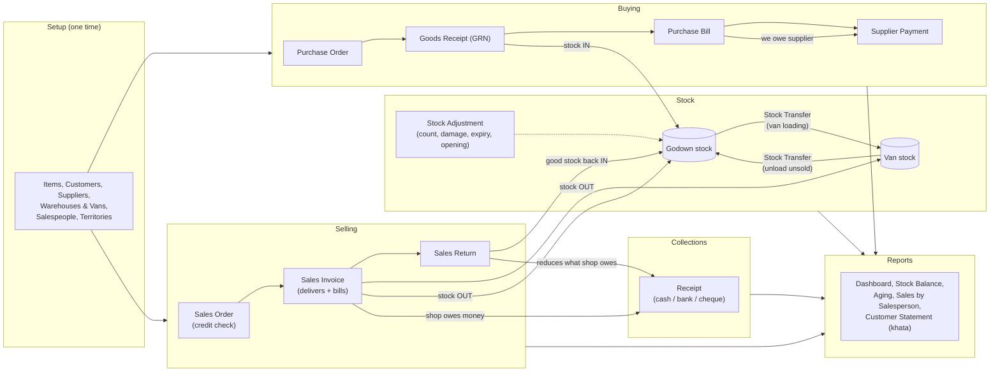
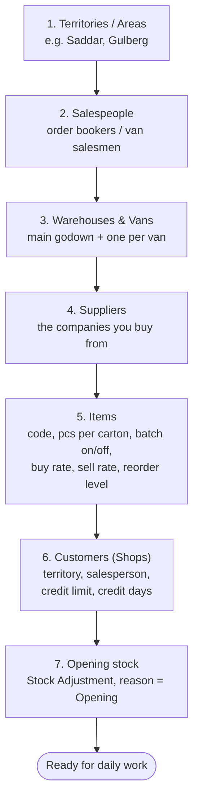
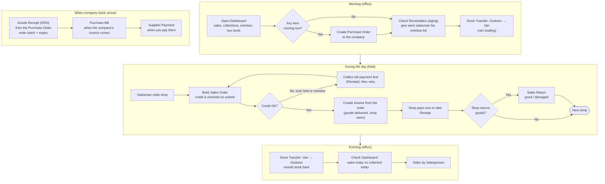
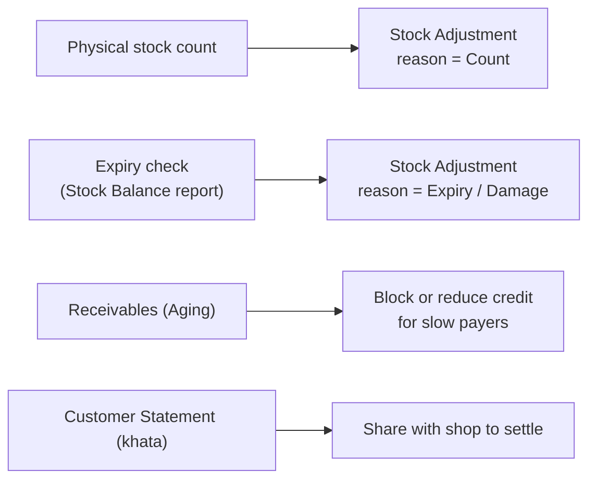
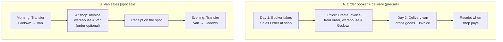
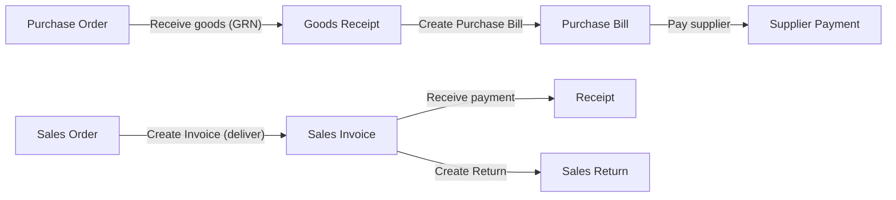

# 1. Overall Journey: How a Distributor Uses DMS

DMS runs the full cycle of an FMCG distributor: **buy stock from the company → keep it in the godown → load vans → sell to shops on credit → collect money → pay the company**.

Every screen in the app belongs to one of these modules:

| Module | Sidebar group | Purpose |
|---|---|---|
| Setup (Masters) | Setup | One-time data: items, customers (shops), suppliers, warehouses/vans, salespeople, territories |
| Buying | Buying | Order stock from the company, receive it, record their bill, pay them |
| Stock | Stock | See what you have, load vans, fix counts, track expiry |
| Selling | Selling | Book orders at shops, deliver and bill, take returns |
| Collections | Selling → Receipts | Collect cash/cheque from shops |
| Reports | Dashboard, Reports | Know who owes, what's selling, what's running low |

---

## 1.1 The big picture

**Two ledgers sit behind everything:**

- **Stock ledger:** every item movement in or out of a godown or van. Rows are never edited or deleted.
- **Party ledger:** what each shop owes you (receivables) and what you owe each supplier (payables).

Documents only touch these ledgers when you **Submit** them. Drafts have no effect. See [02-document-lifecycle.md](02-document-lifecycle.md).

---

## 1.2 Stage 1: First-time setup (do once, in this order)

The order matters because later records point to earlier ones (a customer needs a territory and a salesperson, and so on).

Details: [03-setup-masters.md](03-setup-masters.md).

---

## 1.3 Stage 2: The recommended daily routine

This is the easiest way to run a normal day.

### Weekly / monthly

---

## 1.4 Two ways to sell: pick one per salesman

DMS supports both common FMCG models. Pick the one that matches each salesman.

- **Order booker model** is safest: credit is checked at order time, and the office controls invoicing.
- **Van sales model** is fastest: invoice directly from the van. An invoice without an order is still credit-checked when it is submitted.

---

## 1.5 How documents link to each other

Every next document is created **from** the previous one with a button on its page (for example "Receive goods (GRN)" on a Purchase Order). This copies the remaining quantities, so you never retype them.

| From | Button | Creates | Shown when |
|---|---|---|---|
| Purchase Order | Receive goods (GRN) | Goods Receipt | Order not closed and something is still not received |
| Goods Receipt | Create Purchase Bill | Purchase Bill | Something received is still not billed |
| Purchase Bill | Pay supplier | Supplier Payment | Bill still has an amount open |
| Sales Order | Create Invoice (deliver) | Sales Invoice | Order not closed and something is still not delivered |
| Sales Invoice | Receive payment | Receipt | Invoice still has an amount open |
| Sales Invoice | Create Return | Sales Return | Something invoiced is still not returned |

Partial work is allowed everywhere: you can receive half a PO today and the rest next week, or deliver part of an order now and the rest later.

---

## 1.6 Golden rules for staff

1. **Nothing counts until you Submit.** Drafts are just saved forms.
2. **To fix a mistake, Cancel and create again.** Submitted documents can't be edited. Cancelling adds reverse entries so history stays clean.
3. **Cancel in reverse order.** Cancel the Receipt before the Invoice, the Bill before the GRN, and so on.
4. **Always create the next document from the previous one** (use the buttons), so links and pending quantities stay correct.
5. **Enter quantities as cartons + pieces.** The system stores pieces and converts using the item's pieces-per-carton.
6. **Enter batch and expiry on every GRN** for batch-tracked items. Sales pick the earliest-expiry stock automatically, and expired stock can't be sold.
7. **Collect overdue money before booking new orders.** The system blocks orders for shops with overdue bills.

---

## 1.7 Not in this version (v1)

Login and user roles, the salesman mobile app, route/beat planning, delivery trips with cash settlement, trade schemes and discounts, full accounting (general ledger) and FBR tax, Urdu UI, and opening balances for old shop dues (khata carried in from before DMS).
