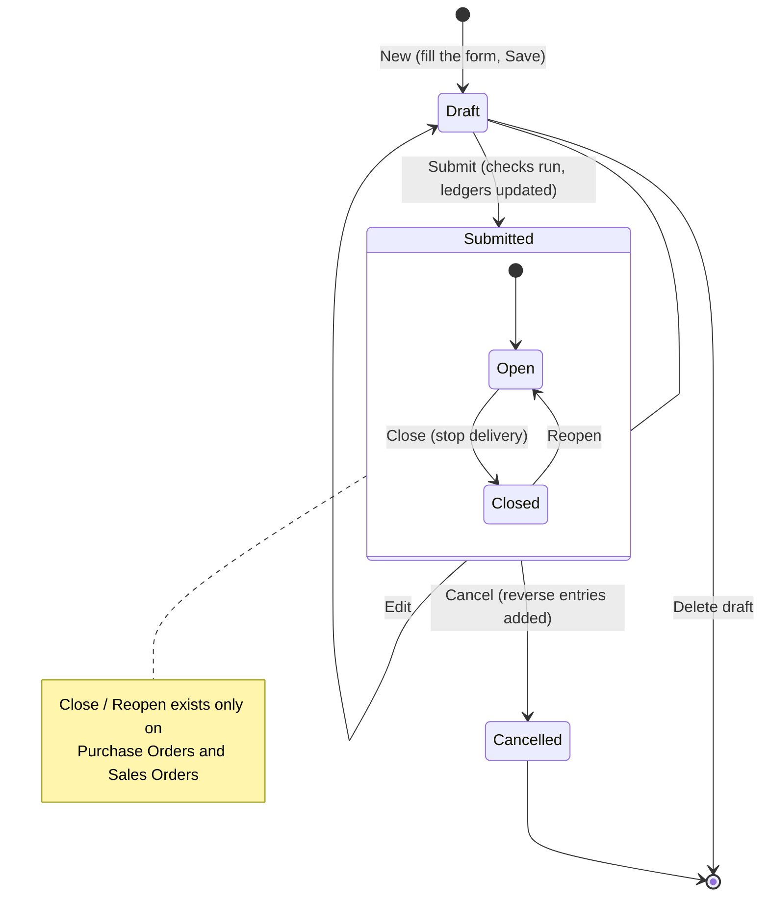
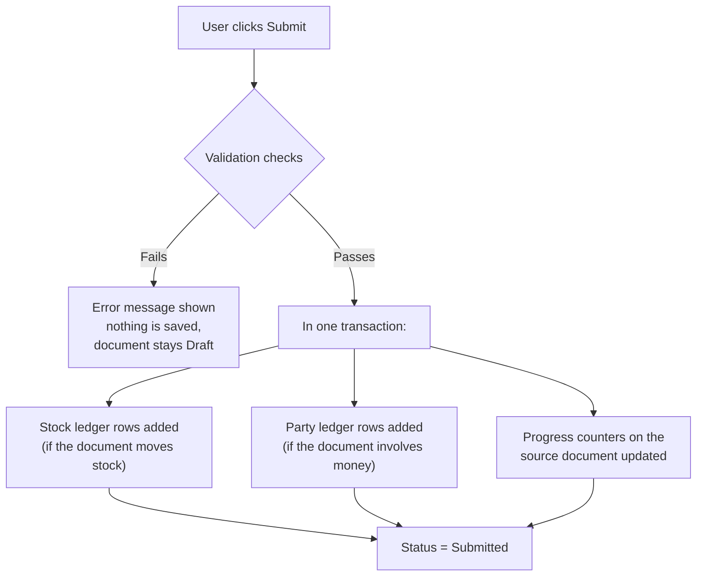
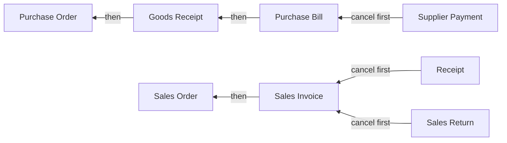

# 2. Document Lifecycle (applies to every document)

All 10 document types follow the same three states:

Sales Order, Sales Invoice, Sales Return, Receipt, Purchase Order, Goods Receipt (GRN), Purchase Bill, Supplier Payment, Stock Transfer, Stock Adjustment.

## 2.1 States

| State | Can edit? | Effect on stock and money | Actions available |
|---|---|---|---|
| **Draft** | Yes | None | Edit, Delete draft, Submit |
| **Submitted** | No | Stock and/or party ledger posted | Cancel, Print, next-step buttons, Close/Reopen (orders only) |
| **Cancelled** | No | Reversed by mirror entries | Print only |

## 2.2 What happens on Submit

Typical checks: enough stock (stock can never go negative), batch not expired, quantity not more than ordered/received/invoiced, customer credit OK.

## 2.3 What each document posts

| Document | Stock effect | Money effect |
|---|---|---|
| Purchase Order | None | None |
| Goods Receipt (GRN) | **+ IN** to the godown (accepted qty only) | None |
| Purchase Bill | None | **We owe supplier +** |
| Supplier Payment | None | **We owe supplier −** |
| Sales Order | None (credit check only) | None |
| Sales Invoice | **− OUT** from the chosen godown/van | **Shop owes us +** |
| Sales Return | **+ IN** for "good" lines only | **Shop owes us −** |
| Receipt | None | **Shop owes us −** |
| Stock Transfer | − OUT from one place, + IN to another | None |
| Stock Adjustment | + or − | None |

## 2.4 Cancel rules: cancel downstream first

A document can't be cancelled while a later document built on it is still submitted.

| To cancel | First cancel |
|---|---|
| Purchase Order | Its Goods Receipts |
| Goods Receipt | Its Purchase Bills |
| Purchase Bill | Supplier Payments allocated to it |
| Sales Order | Its Invoices (or just **Close** the order instead) |
| Sales Invoice | Its Sales Returns and Receipts allocated to it |

**Close vs Cancel on orders:** use **Close** when the rest of an order will never be delivered/received but what was already done is correct. Use **Cancel** only when the whole order was a mistake.

## 2.5 Document numbering

Numbers are automatic, per type and year, for example `PO-2026-00001`. They never repeat.
