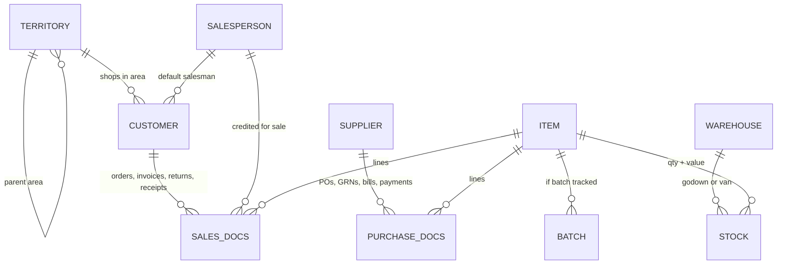
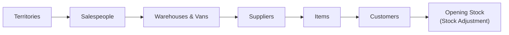
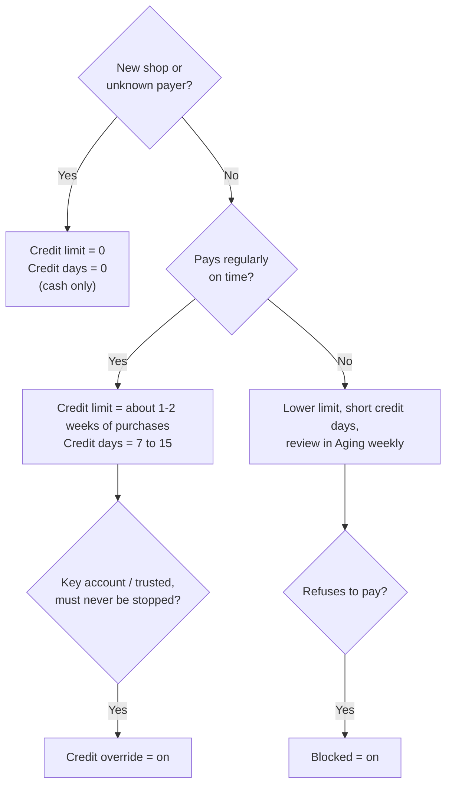

# 3. Setup (Masters)

Sidebar: **Setup**. Master data is entered once and kept up to date. Every document picks its customer, item, warehouse and so on from here.

## 3.1 How masters connect

## 3.2 Setup order

## 3.3 Each master: what to enter

### Territories / Areas
| Field | Notes |
|---|---|
| Name | e.g. "Saddar", "Gulberg Block 5" |
| Parent | Optional. Lets you group areas, e.g. "Lahore → Gulberg" |

### Salespeople
| Field | Notes |
|---|---|
| Name, Phone | Order booker or van salesman |
| Active | Turn off when someone leaves (history is kept) |

### Warehouses & Vans
| Field | Notes |
|---|---|
| Name | "Main Godown", "Van 1 – LEA-1234" |
| Kind | **Godown** or **Van** |
| Active | Turn off when no longer used |

**Tip:** create one **Van** warehouse per vehicle. Van stock is then visible separately, and each salesman is accountable for his van.

### Suppliers
| Field | Notes |
|---|---|
| Name, Phone, Address | The principal/company you buy from |

### Items
| Field | Notes |
|---|---|
| Code, Name | Short code is used for quick search |
| Pcs per carton | e.g. 24. All quantities are stored in pieces; forms take cartons + pieces |
| Batch tracked | Turn **on** for anything with an expiry date (food, medicine, cosmetics) |
| Buy rate | Default purchase price per piece |
| Sell rate | Default selling price per piece |
| Reorder level | When stock falls below this (in pieces), the item shows in "Running low" on the Dashboard |
| Active | Turn off discontinued items |

### Customers (Shops)
| Field | Notes |
|---|---|
| Name, Owner name, Phone, Address | Shop details |
| Territory | Area the shop is in |
| Salesperson | Default salesman; filled into new orders, invoices and receipts automatically |
| **Credit limit** | Max the shop can owe (bills + undelivered orders). **Leave empty = no limit**. Set 0 for cash-only |
| **Credit days** | Days until an invoice is due. 0 = due same day. Due date = invoice date + credit days |
| Credit override | If on, credit and overdue checks are skipped for this shop. Use rarely (trusted key accounts) |
| Blocked | If on, no new orders/invoices can be submitted for this shop |

## 3.4 Choosing credit settings

## 3.5 Opening stock

On day one, enter what is already in the godown and vans with a **Stock Adjustment**, reason **Opening**, one per warehouse. For batch-tracked items, enter the batch number and expiry for each line. Enter the cost rate. If you leave it 0, the item's buy rate is used. See [05-stock.md](05-stock.md).
