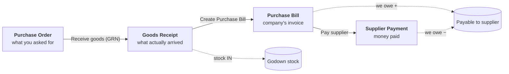
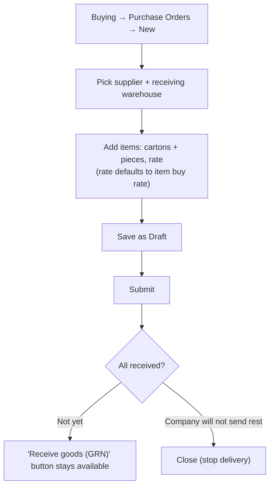
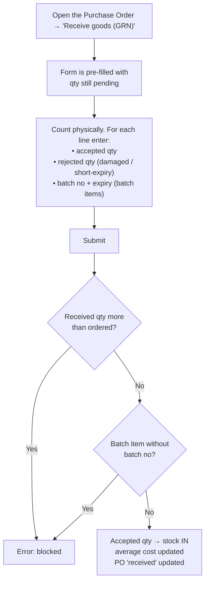
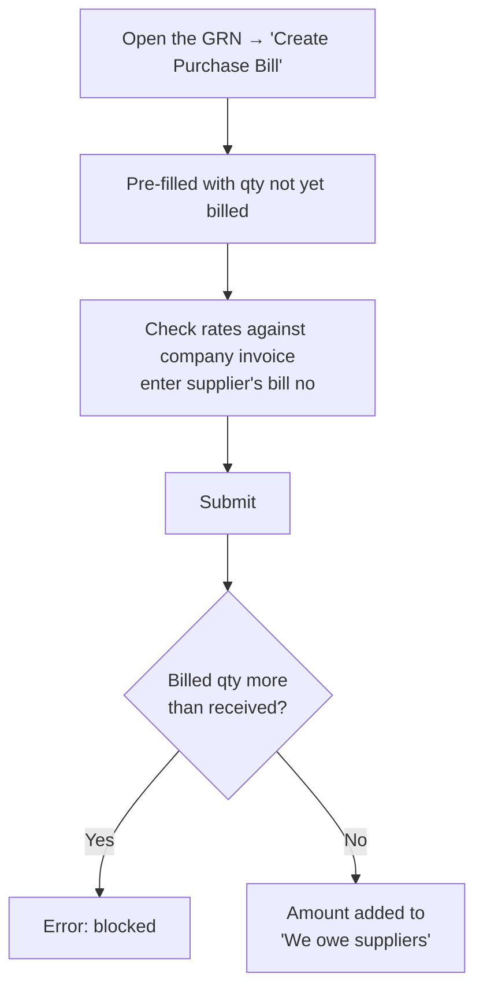
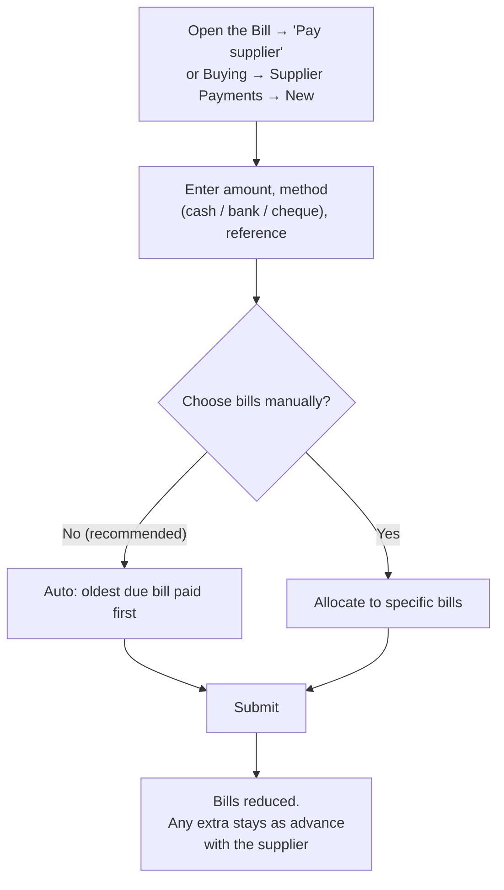

# 4. Buying (Procurement)

Sidebar: **Buying**. This covers buying stock from the company (supplier) and paying them.

## 4.1 Flow

| Step | Who | When | Effect |
|---|---|---|---|
| Purchase Order | Owner / manager | When stock is low or before company's cut-off | None. A record of what you ordered |
| Goods Receipt | Godown keeper | When the truck arrives | Accepted qty added to stock at the GRN rate |
| Purchase Bill | Accounts | When the company's invoice arrives | Amount added to what you owe the supplier |
| Supplier Payment | Owner / accounts | When you pay | Reduces what you owe |

## 4.2 Purchase Order

- A PO doesn't change stock or money.
- **Close** stops further receiving. **Reopen** allows it again.
- A PO can be cancelled only if it has no submitted GRNs.

## 4.3 Goods Receipt (GRN)

- **Rejected qty** is recorded for your claim with the company but is **not** added to stock.
- A GRN without a PO is allowed (for unplanned deliveries).
- Partial GRNs are fine. The PO keeps showing what's pending.
- The same batch number for the same item can't have two different expiry dates.
- **Cost:** stock is valued by **moving average**. Each GRN mixes its rate into the item's average cost in that warehouse.

## 4.4 Purchase Bill

- Bill only what was **received**. This stops paying for short-supplied goods.

## 4.5 Supplier Payment

## 4.6 Recommended practice

1. Always start from a **PO**, even for phone orders. It makes short-supply visible.
2. Do the **GRN on the day stock arrives**, before selling it. Stock that isn't in the system can't be sold.
3. Enter **rejected qty** honestly. It's your record for claims.
4. Create the **Bill from the GRN**, never from scratch.
5. Pay with auto-allocation unless the company tells you which bill a payment is for.
