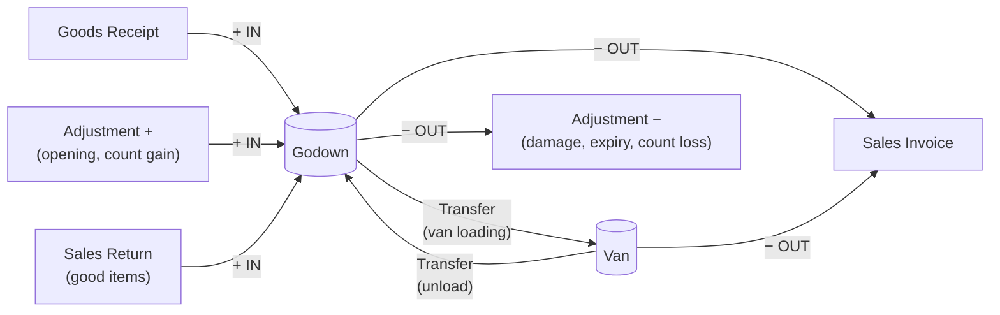
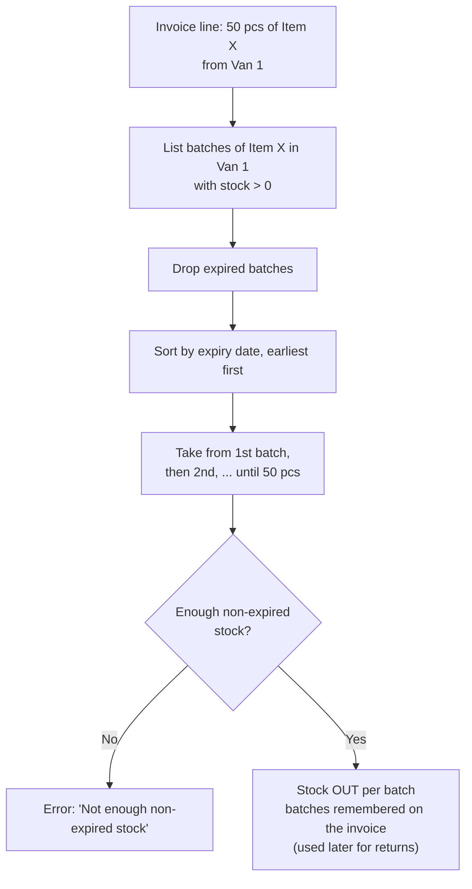
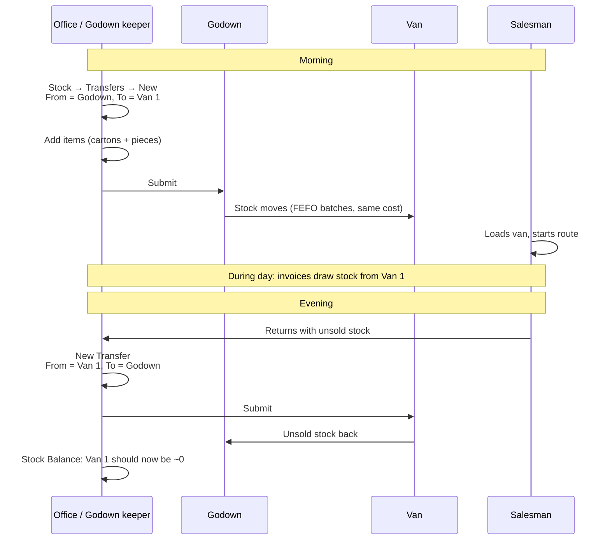
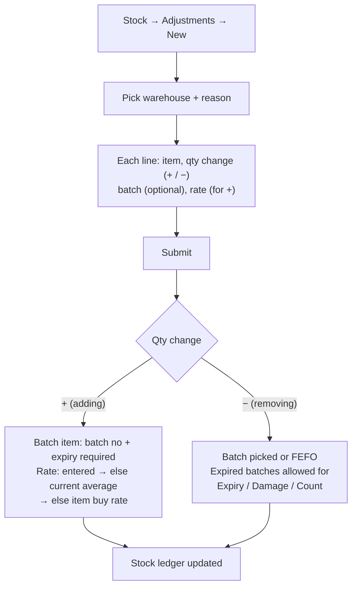
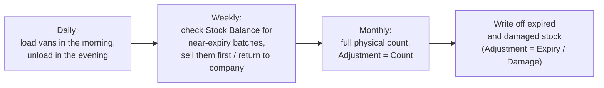

# 5. Stock (Inventory)

Sidebar: **Stock**. Screens: Stock Balance, Transfers (Van Loading), Adjustments, Stock Ledger.

## 5.1 Where stock comes from and goes

Every movement is one row in the **Stock Ledger** (item × warehouse × batch). Rows are never edited or deleted. Cancelling a document adds reverse rows.

## 5.2 Key rules

| Rule | Meaning for staff |
|---|---|
| **No negative stock** | You can't invoice or transfer more than is physically there. Do the GRN first |
| **Quantities in pieces** | Forms take cartons + pieces and convert automatically |
| **Moving-average cost** | Each warehouse keeps an average cost per item. Profit on invoices uses this cost |
| **FEFO for batch items** | First-Expiry-First-Out. Sales and transfers automatically take the batch expiring soonest |
| **Expired stock can't be sold** | Expired batches are skipped on sale. Write them off with an Adjustment |
| **Posting date = today** | Stock entries can't be back-dated |

## 5.3 FEFO batch picking (automatic)

## 5.4 Stock Transfer (van loading / unloading)

- From and To must be different.
- For batch items you can pick a batch, or leave it blank and FEFO picks for you.
- A transfer never changes total stock **value**. The cost moves with the goods.

## 5.5 Stock Adjustment

Used to correct the system to match reality.

| Reason | Use it when | Direction |
|---|---|---|
| **Opening** | Day-one stock entry | + |
| **Count** | Physical count differs from the system | + or − |
| **Damage** | Broken, leaking, rat-damaged goods | − |
| **Expiry** | Writing off expired stock | − |
| **Other** | Anything else (give remarks) | + or − |

## 5.6 Recommended stock routine

## 5.7 Stock reports

- **Stock Balance:** qty and value per item per warehouse, batches with expiry dates.
- **Stock Ledger:** every movement of one item, with running qty and cost. Use it to answer "where did this stock go?"
