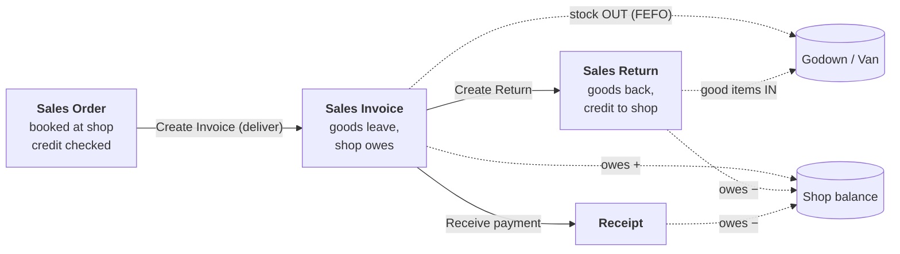
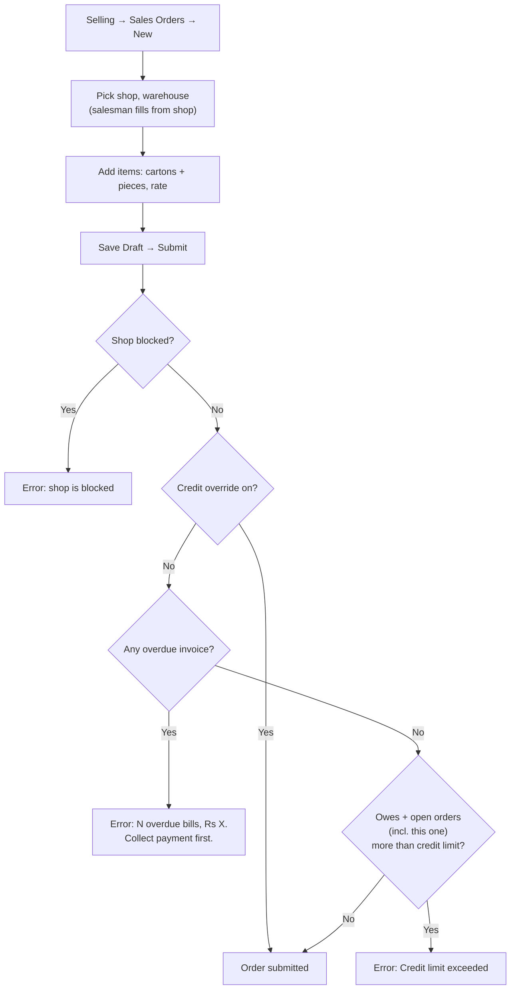
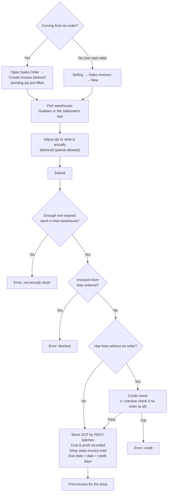
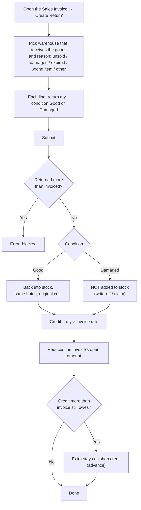

# 6. Selling

Sidebar: **Selling**. Screens: Sales Orders, Sales Invoices, Sales Returns (Receipts are in [07-collections.md](07-collections.md)).

## 6.1 Flow

| Document | Stock | Shop balance | Notes |
|---|---|---|---|
| Sales Order | — | — | Credit check on submit |
| Sales Invoice | OUT | + total | Due date = date + credit days |
| Sales Return | IN (good only) | − total | At the original invoice rate |

## 6.2 Sales Order + credit check

**Exposure** = what the shop owes now + value of its submitted orders not yet invoiced.

How to clear a block:

| Message | Fix |
|---|---|
| Overdue bills | Collect payment (Receipt), then submit again |
| Credit limit exceeded | Collect payment, reduce the order, or raise the limit in the customer master |
| Shop is blocked | Unblock in the customer master (manager decision) |

**Close (stop delivery):** if the shop no longer wants the rest of the order, Close it. Closed orders don't count toward exposure. Reopening an order re-checks the credit limit.

## 6.3 Sales Invoice (delivery + billing in one step)

- Lines from an order were already credit-checked at order time, so they aren't checked again.
- One order can have several invoices (partial deliveries).
- An invoice can't be cancelled while it has submitted returns or receipts.

## 6.4 Sales Return

- Returns are always linked to an invoice, so the rate and batches are exact.
- Mark **Damaged** for anything that can't be sold again. Stock stays accurate.

## 6.5 Recommended selling practice

1. **Book an order first** whenever possible. It's the credit gate.
2. **Invoice from the van warehouse** for van sales, so van stock stays accurate.
3. **Invoice only what is physically handed over.** Deliver the rest later on another invoice, or Close the order.
4. **Print and give the invoice** to the shop, and get it signed.
5. Take returns **against the original invoice** and mark the condition honestly.
6. Before a salesman's route, give him the overdue list (Receivables Aging filtered by salesman), because those shops will be blocked.
