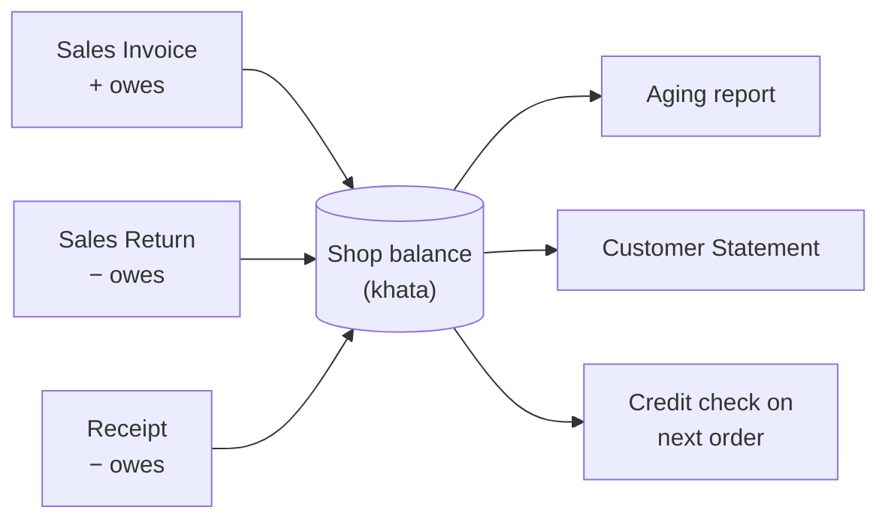
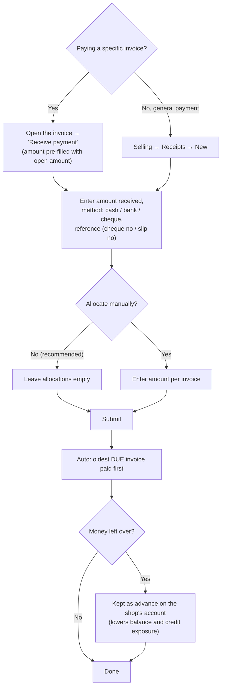
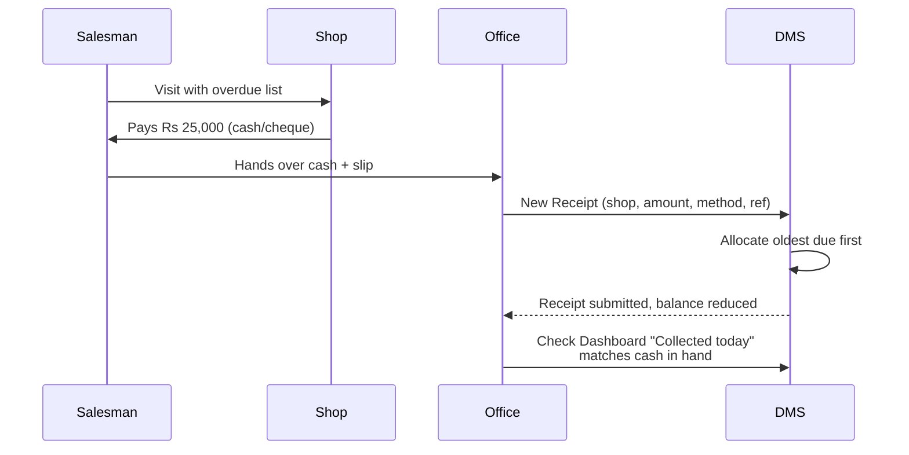
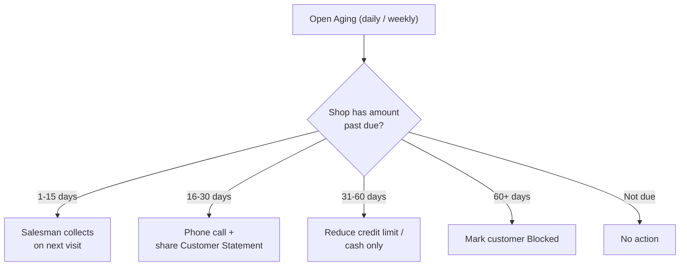

# 7. Collections (Receipts from Shops)

Sidebar: **Selling → Receipts**, and **Reports → Receivables (Aging)**.

## 7.1 How a shop's balance moves

Each invoice is tracked separately ("open item"). Its **open amount** = invoice total − returns − payments allocated to it.

## 7.2 Taking a receipt

## 7.3 Auto-allocation example

Shop "Ali Store" has three open invoices and pays **Rs 25,000**:

| Invoice | Due date | Open | Allocated |
|---|---|---|---|
| SI-2026-00010 | 01-Nov | 8,000 | **8,000** (oldest due, fully paid) |
| SI-2026-00015 | 05-Nov | 12,000 | **12,000** (fully paid) |
| SI-2026-00021 | 12-Nov | 10,000 | **5,000** (partly paid, 5,000 still open) |

Nothing left over, so no advance. Because the oldest invoices are cleared first, the shop stops being "overdue" as quickly as possible.

## 7.4 Manual allocation rules

- Each allocated amount must be more than 0 and not more than that invoice's open amount.
- The total allocated can't be more than the receipt amount. Anything not allocated becomes an advance.

## 7.5 Fixing a wrong receipt

Cancel it (this reverses its effect on the shop balance) and create a new one. Note that the invoice it paid becomes open again.

## 7.6 Receivables Aging

**Reports → Receivables (Aging)** shows, per shop, what is owed and how late:

| Column | Meaning |
|---|---|
| Not due | Within credit days |
| 1–15 days | Slightly late |
| 16–30 days | Follow up |
| 31–60 days | Serious, consider blocking |
| 60+ days | Bad debt risk, block |

## 7.7 Customer Statement (khata)

Open a customer to see every invoice, return and receipt with a running balance. Print it and share it with the shop owner to agree on the balance.

## 7.8 Recommended collection practice

1. Record receipts **the same day** cash is handed in.
2. Use **auto-allocation** unless the shop insists on paying a specific bill.
3. Always enter the **cheque number / bank slip** in the reference.
4. Every evening: **Dashboard "Collected today"** should equal cash + cheques in hand.
5. Weekly: review **Aging** with each salesman.
