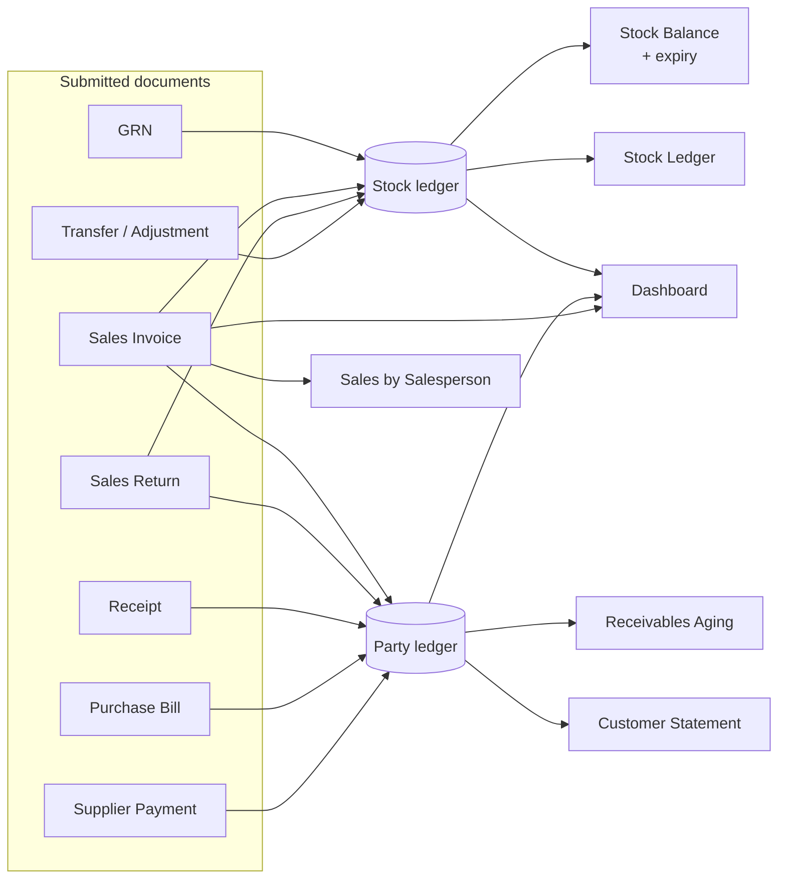
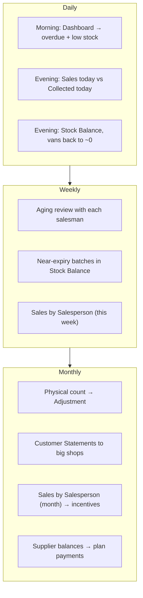

# 8. Reports and Dashboard

## 8.1 Where each report gets its data

Only **submitted** documents appear in reports. Drafts don't.

## 8.2 Dashboard ("Today at a glance")

| Tile / card | Shows | Action |
|---|---|---|
| Sales today | Invoice total today + count | Compare with the target |
| Collected today | Receipts today | Match with cash in hand |
| Shops owe us | Total receivable | Watch the trend |
| We owe suppliers | Total payable | Plan payments |
| Money in stock | Stock value at cost | Watch over-stocking |
| Overdue bills: collect first | Shops with overdue invoices | Give to salesmen |
| Running low: reorder | Items below reorder level | Create a Purchase Order |
| Top salespeople this month | Ranking | Incentives / follow-up |

## 8.3 Report guide

| Report | Sidebar | Question it answers | How often |
|---|---|---|---|
| Stock Balance | Stock → Stock Balance | How much of each item is in each godown/van? Which batches expire soon? | Daily |
| Stock Ledger | Stock → Stock Ledger | Where did this item's stock go, and when? | When investigating |
| Receivables (Aging) | Reports → Receivables | Who owes, and how late? | Daily / weekly |
| Sales by Salesperson | Reports → Sales by Salesperson | Who sold how much in a date range? | Weekly / monthly |
| Customer Statement | Open any customer | Full khata of one shop with running balance | On request / month end |

## 8.4 Recommended reporting rhythm

